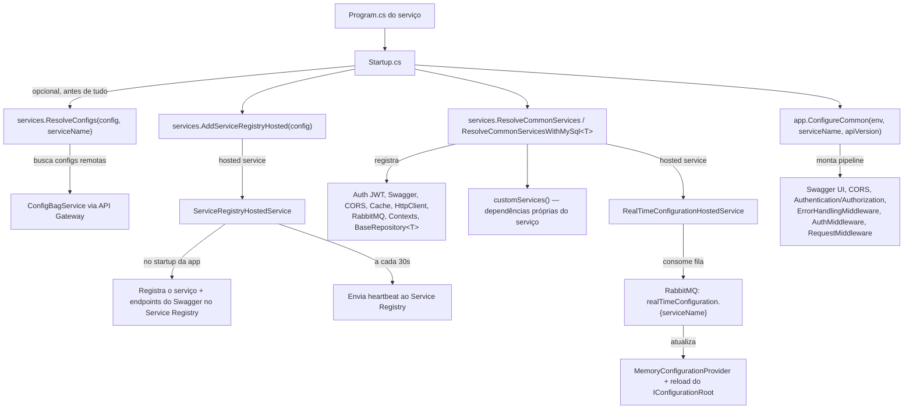
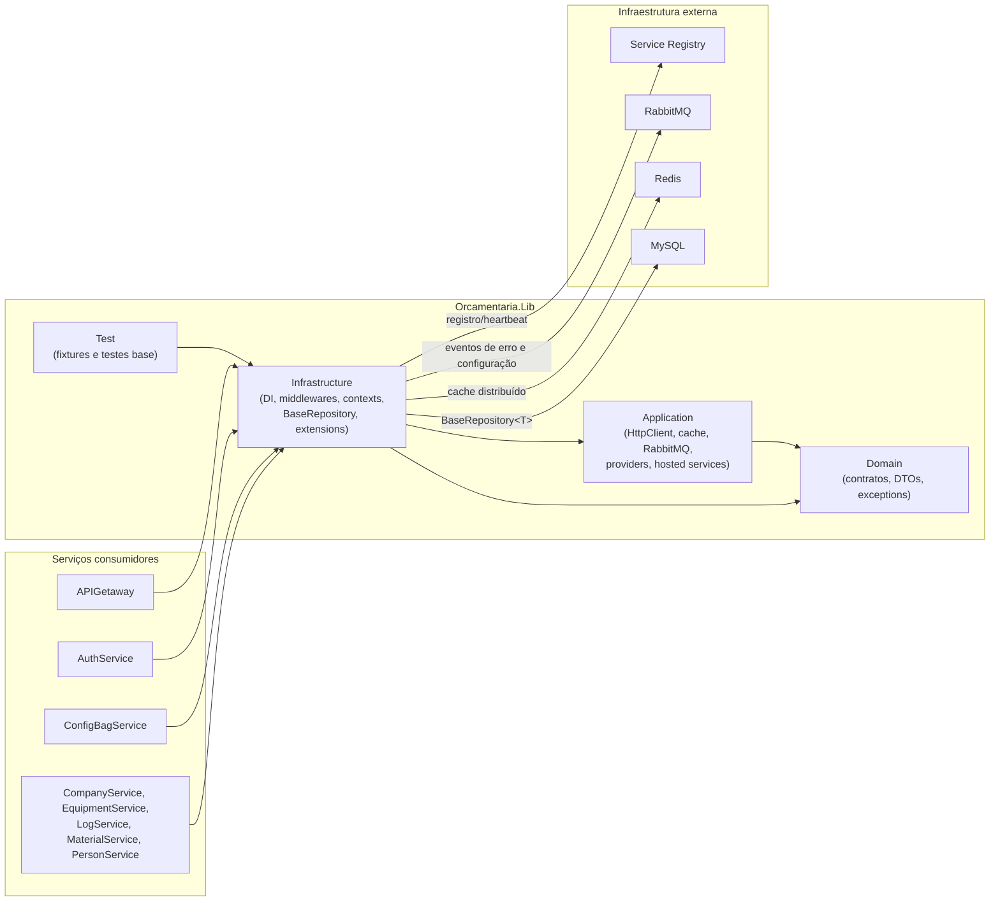
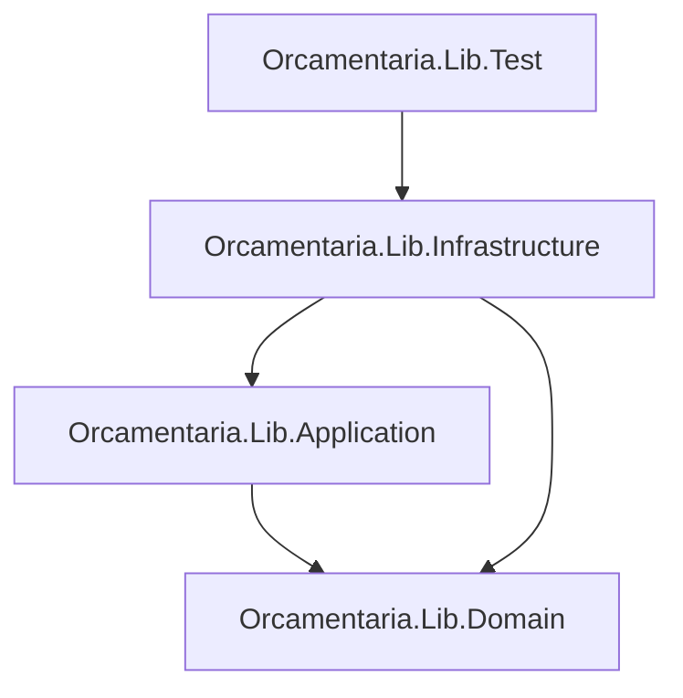

# 📚 Orcamentaria.Lib

Biblioteca compartilhada (NuGet interno) do ecossistema de microsserviços **Orcamentaria**, publicada em quatro pacotes — `Orcamentaria.Lib.Domain`, `Orcamentaria.Lib.Application`, `Orcamentaria.Lib.Infrastructure` e `Orcamentaria.Lib.Test` — que concentram a infraestrutura transversal (autenticação, Swagger, CORS, cache, RabbitMQ, HTTP client, contexto de requisição) usada por todos os serviços .NET do ecossistema: Gateway, AuthService, ConfigBagService, CompanyService, EquipmentService, LogService, MaterialService e PersonService.

---

## 🎯 Objetivo

Em uma arquitetura com múltiplos microsserviços .NET independentes, boa parte da infraestrutura (autenticação JWT, Swagger, CORS, mensageria, cache, cliente HTTP, contexto de requisição, repositório base) se repetiria em cada serviço. O `Orcamentaria.Lib` resolve isso concentrando essa infraestrutura em um pacote NuGet único, consumido por todos os serviços via duas chamadas de extensão:

1. `services.ResolveCommonServices(...)` (ou `ResolveCommonServicesWithMySql<TContext>(...)`) em `Startup.ConfigureServices` — registra toda a infraestrutura comum (autenticação, Swagger, CORS, cache, mensageria, HTTP client, contexto de requisição, repositório base) e devolve a `IConfiguration` efetiva do serviço;
2. `app.ConfigureCommon(...)` em `Startup.Configure` — monta o pipeline HTTP comum (Swagger, CORS, autenticação/autorização, middlewares de erro/auth/request).

Isso permite que cada serviço concentre seu `Startup.cs` apenas nas suas próprias dependências de negócio, delegando a infraestrutura transversal para a biblioteca.

---

## 🧰 Tecnologias

| Tecnologia | Versão | Finalidade |
|---|---|---|
| C# / .NET | 9 | Linguagem e runtime dos quatro projetos |
| `Orcamentaria.Lib.Domain` | 10.1.3 | Contratos, DTOs, modelos, enums e exceptions compartilhados, sem dependência de frameworks web |
| `Orcamentaria.Lib.Application` | 2.1.6 | Implementações de serviços de aplicação (HTTP client, cache, RabbitMQ, hosted services, providers de token) |
| `Orcamentaria.Lib.Infrastructure` | 5.4.2 | Composição de injeção de dependência, middlewares, contextos e repositório base para EF Core |
| `Orcamentaria.Lib.Test` | 1.1.5 | Fixtures e classes de teste base reutilizáveis pelos projetos de teste dos serviços consumidores |
| FluentValidation | 12.1.0 | Validação de entidades (`IValidator`) |
| Microsoft.IdentityModel.Tokens / System.IdentityModel.Tokens.Jwt | 8.14.0 | Geração e validação de chaves/tokens JWT (RSA) |
| MongoDB.Bson | 3.5.0 | Tipos Bson usados em modelos do Domain |
| Polly | 8.6.4 | Pipelines de resiliência (retry, circuit breaker, fallback) |
| Microsoft.AspNetCore.Authentication.JwtBearer | 9.0.11 | Autenticação JWT Bearer com múltiplos esquemas |
| Microsoft.EntityFrameworkCore / MySql.EntityFrameworkCore | 9.0.11 / 9.0.9 | Repositório base genérico sobre `DbContext` |
| Swashbuckle.AspNetCore / Microsoft.OpenApi | 10.0.1 / 2.3.9 | Geração de documentação Swagger/OpenAPI |
| RabbitMQ.Client | 7.2.0 | Publicação/consumo de mensagens (erros, configuração em tempo real) |
| StackExchange.Redis / Microsoft.Extensions.Caching.StackExchangeRedis | 3.0.17 / 9.0.18 | Cache distribuído e operações atômicas via Redis |
| Microsoft.Extensions.Caching.Memory | 10.0.0 | Cache em memória |
| xUnit / Moq / Moq.AutoMock / FluentAssertions / Bogus | — | Stack de testes (`Orcamentaria.Lib.Test`) |

---

## 🏗️ Arquitetura

A biblioteca não é um serviço HTTP standalone: é uma dependência compartilhada organizada em quatro projetos, seguindo o mesmo sentido de dependência em camadas dos serviços consumidores:

- **`Orcamentaria.Lib.Domain`**: contratos (`ICacheService`, `IAtomicCacheService`, `IHttpClientService`, `IServiceRegistryService`, `ITokenProvider`, `IBaseRepository<T>`, contextos, etc.), DTOs, modelos de configuração, enums e exceptions de domínio. Não depende de nenhum outro projeto da biblioteca nem de frameworks web.
- **`Orcamentaria.Lib.Application`**: implementações concretas dos contratos do Domain — `HttpClientService`, `ServiceRegistryService`, `ApiGetawayService`, `MemoryCacheService`, `RedisCacheService`, `RedisAtomicCacheService`, serviços RabbitMQ, `RsaService`, `LogService`, providers de token e hosted services. Depende apenas do Domain.
- **`Orcamentaria.Lib.Infrastructure`**: ponto de composição consumido pelos serviços — `DependencyInjectionConfigure` (`ResolveCommonServices`/`ResolveCommonServicesWithMySql`), `ApplicationBuilderConfigure` (`ConfigureCommon`), `EnvsConfigure` (`ResolveConfigs`), `ServiceRegistryHostedConfigure` (`AddServiceRegistryHosted`), extensões de cache Redis e resiliência, middlewares HTTP, contextos de requisição/autenticação e o `BaseRepository<TEntity>` genérico sobre EF Core. Depende do Application e do Domain.
- **`Orcamentaria.Lib.Test`**: fixtures (`BaseFixture<T>`) e suítes de teste genéricas (`ReadWithCompanyRepositoryTests<T,C>`, `ReadWithoutCompanyRepositoryTests<T,C>`, `WriteWithCompanyRepositoryTests<T,C>`, `DeleteWithCompanyRepositoryTests<T,C>`) para exercitar `BaseRepository<TEntity>`. É publicado como pacote NuGet e referenciado pelos projetos de teste dos serviços consumidores (ex.: `Orcamentaria.AuthService.Test`, `Orcamentaria.CompanyService.Test`), que os reaproveitam para testar seus próprios repositórios sem reescrever os cenários de filtro por `CompanyId`, ordenação e paginação.

Fluxo de dependência entre pacotes: `Infrastructure → Application → Domain`, e `Test → Infrastructure`.

---

## 📁 Estrutura do Projeto

```text
Orcamentaria.Lib/
├── Orcamentaria.Lib.Domain/                    # Contratos, DTOs, modelos e exceptions
│   ├── Contexts/                               #   IRequestContext, IUserAuthContext, IServiceAuthContext
│   ├── DTOs/                                   #   Authentication, ConfigurationBag, Request, ServiceRegistry
│   ├── Entities/TenantEntity.cs
│   ├── Enums/                                  #   ErrorCodeEnum, ExceptionTypeEnum, StateEnum, etc.
│   ├── HostedServices/IServiceRegistryHostedService.cs
│   ├── Initializers/IInitializer.cs
│   ├── Models/
│   │   ├── @Logs/                              #   ExceptionLog, ExceptionOrigin e derivados
│   │   ├── Configurations/                     #   ApiGetawayConfiguration, MessageBrokerConfiguration,
│   │   │                                        #   RedisConfiguration, ServiceConfiguration, ServiceRegistryConfiguration...
│   │   ├── Exceptions/                         #   BusinessException, ValidationException, UnauthorizedException...
│   │   ├── Resilience/                         #   RetryResilience, CircuitBreakerResilience
│   │   └── Responses/                          #   Response<T>, ResponseError, ResponsePagination
│   ├── Providers/ITokenProvider.cs
│   ├── Repositories/IBaseRepository.cs
│   ├── Services/                               #   ICacheService, IAtomicCacheService, IHttpClientService,
│   │                                            #   IServiceRegistryService, ILogService, IRsaService...
│   └── Validators/IValidator.cs
├── Orcamentaria.Lib.Application/               # Implementações de serviços de aplicação
│   ├── HostedServices/                         #   RealTimeConfigurationHostedService, ServiceRegistryHostedService
│   ├── Providers/                              #   BootstrapTokenProvider, ServiceTokenProvider
│   └── Services/                               #   HttpClientService, ServiceRegistryService, ApiGetawayService,
│                                                #   MemoryCacheService, RedisCacheService, RedisAtomicCacheService,
│                                                #   RabbitMqConsumeService, RabbitMqPublishService,
│                                                #   RabbitMqTopologyBrokerService, RsaService, LogService
├── Orcamentaria.Lib.Infrastructure/            # Composição e infraestrutura consumida pelos serviços
│   ├── Configures/                             #   DependencyInjectionConfigure, ApplicationBuilderConfigure,
│   │                                            #   EnvsConfigure, ServiceRegistryHostedConfigure
│   ├── Contexts/                               #   RequestContext, UserAuthContext, ServiceAuthContext
│   ├── Extensions/                             #   RedisExtension (AddRedisCacheService), ResilienceExtension
│   ├── Helpers/                                #   ConvertHelper, GridQueryHelper, ServiceNameHelper
│   ├── Initializers/ConfigurationBagInitializer.cs
│   ├── Middlewares/                            #   AuthMiddleware, ErrorHandlingMiddleware, RequestMiddleware
│   └── Repositories/BaseRepository.cs
├── Orcamentaria.Lib.Test/                      # Fixtures e testes base reutilizáveis
│   ├── Fixtures/BaseFixture.cs
│   └── Repositories/                           #   ReadWithCompanyRepositoryTests, ReadWithoutCompanyRepositoryTests,
│                                                #   WriteWithCompanyRepositoryTests, DeleteWithCompanyRepositoryTests
└── Orcamentaria.Lib.sln
```

---

## 🔄 Como um Serviço Consumidor Utiliza a Biblioteca



**Passo a passo (baseado nos `Startup.cs` dos serviços consumidores):**

1. *(Opcional, para serviços que carregam configuração remota, como `LogService`, `EquipmentService`, `CompanyService`, `MaterialService`, `PersonService`)*: `services.ResolveConfigs(Configuration, serviceName)` chama internamente `ConfigurationBagInitializer`, que autentica via `BootstrapTokenProvider` (segredo `BOOTSTRAPSECRET`), busca a "configuration bag" do serviço no `ConfigBagService` através do API Gateway e mescla o resultado (connection strings, seções arbitrárias, `RealTimeConfigurations`) na `IConfiguration` do serviço.
2. `services.AddServiceRegistryHosted(Configuration)` registra `ServiceConfiguration` e adiciona o `ServiceRegistryHostedService`, responsável por registrar o serviço (lendo seus endpoints do próprio `swagger.json`) no Service Registry ao iniciar a aplicação e enviar heartbeats periódicos.
3. `services.ResolveCommonServices(...)` — ou `ResolveCommonServicesWithMySql<TContext>(...)` quando o serviço usa EF Core/MySQL — registra toda a infraestrutura comum (detalhada na seção seguinte) e executa o delegate `customServices` para que o serviço registre suas próprias dependências (repositórios, serviços, mappers, validators).
4. `app.ConfigureCommon(env, serviceName, apiVersion)` monta o pipeline HTTP: proteção do `swagger.json` por `ClientId`/`ClientSecret`, Swagger UI (em desenvolvimento), CORS, autenticação/autorização e os três middlewares (`ErrorHandlingMiddleware`, `AuthMiddleware`, `RequestMiddleware`).

---

## 🧩 Capacidades Fornecidas

| Capacidade | Onde está implementada | O que faz |
|---|---|---|
| **Autenticação JWT (RS256)** | `DependencyInjectionConfigure.ResolveCommonServices` | Configura três esquemas JWT Bearer (`userJwt`, `serviceJwt`, `bootstrapJwt`) selecionados dinamicamente por `AddPolicyScheme` a partir do claim `token_use`/`aud` do token, cada um validado com uma `RsaSecurityKey` própria carregada via `IRsaService`. |
| **Contexto de autenticação por requisição** | `AuthMiddleware`, `UserAuthContext`, `ServiceAuthContext`, `RequestContext` | Após a autenticação, popula `IUserAuthContext`/`IServiceAuthContext` com os claims do token (UserId, Email, CompanyId, ServiceId, Nome, BearerToken) e `IRequestContext` com `RequestId`/`RequestOrderId` para correlação entre chamadas. |
| **Swagger / OpenAPI** | `ResolveCommonServices` + `ApplicationBuilderConfigure.ConfigureCommon` | Gera documentação OpenAPI com suporte a Bearer token; expõe Swagger UI apenas em ambiente de desenvolvimento; protege o `swagger.json` com validação de headers `ClientId`/`ClientSecret`. |
| **CORS** | `ResolveCommonServices` | Política `_myAllowSpecificOrigins` liberando qualquer origem, header e método. |
| **Cache** | `MemoryCacheService` (`ICacheService` keyed `"memory"`), `RedisCacheService` (`ICacheService` keyed `"redis"`, via `AddRedisCacheService`), `RedisAtomicCacheService` (`IAtomicCacheService`) | Abstração `ICacheService` com `GetAsync`/`SetAsync`/`RemoveAsync`/`GetOrCreateAsync`, implementada em memória (`IMemoryCache`) e em Redis (`IDistributedCache`); `IAtomicCacheService.TrySetAsync` usa `StringSetAsync` com `When.NotExists` no Redis para operações atômicas do tipo "definir se não existir" com janela de expiração. |
| **HTTP Client / Roteamento** | `HttpClientService`, `ApiGetawayService`, `ServiceRegistryService` | `HttpClientService.SendAsync<T>` envia requisições propagando `RequestId`/`RequestOrderId` e `Authorization: Bearer`, mapeando erros HTTP (`ServiceUnavailableException`, `IntegrationException`, `UnauthorizedException`); `ApiGetawayService.Routing<T>` monta e envia um `RequestDTO` ao endpoint `api/v1/Routing` do API Gateway; `ServiceRegistryService` usa ambos para registrar o serviço, enviar heartbeats e obter registros do Service Registry. |
| **Mensageria (RabbitMQ)** | `RabbitMqPublishService`, `RabbitMqConsumeService`, `RabbitMqTopologyBrokerService` | Publica mensagens em filas/exchanges tópico, consome filas com ack/nack manual e cria/vincula exchanges e filas de tópico sob demanda. |
| **Configuração em tempo real** | `RealTimeConfigurationHostedService`, `RealTimeConfigurationMessageBrokerProcessorService` | Cada serviço consome a fila `realTimeConfiguration.{serviceName}` (exchange tópico `realTimeConfiguration`); ao receber uma mensagem, atualiza um `MemoryConfigurationProvider` em runtime e recarrega o `IConfigurationRoot`, permitindo ajustar configurações sem reiniciar o processo. |
| **Bootstrap de configuração remota** | `ConfigurationBagInitializer`, `EnvsConfigure.ResolveConfigs` | No startup, autentica-se via token de bootstrap, busca a configuration bag do serviço no `ConfigBagService` e mescla connection strings, configurações arbitrárias e `RealTimeConfigurations` na configuração da aplicação. |
| **Descoberta e registro de serviço** | `ServiceRegistryHostedService`, `ServiceRegistryHostedConfigure.AddServiceRegistryHosted` | No startup da aplicação, lê o próprio `swagger.json` para extrair os endpoints expostos, registra o serviço no Service Registry e mantém o registro vivo com heartbeats a cada 30 segundos (com retentativas). |
| **Repositório base** | `BaseRepository<TEntity>`, `IBaseRepository<TEntity>` | CRUD genérico sobre `DbSet<TEntity>` do EF Core, com filtragem automática por `CompanyId` (multi-tenant), preenchimento automático de `CreatedAt`/`CreatedBy`/`UpdatedAt`/`UpdatedBy` quando os campos existem na entidade, filtros dinâmicos (`FilterParam`), ordenação e paginação (`GridQueryHelper`). |
| **Tratamento de erros e logging** | `ErrorHandlingMiddleware`, `LogService` | Captura exceptions do tipo `DefaultException`, formata a resposta HTTP em JSON com o `ErrorCode` correspondente e publica um `ExceptionLog` no RabbitMQ (exchange `error`, roteado por severidade) para centralização de logs. |
| **Resiliência** | `ResilienceExtension.AddResilience<T,R>` | Monta um `ResiliencePipeline<T>` (Polly) combinando fallback, retry e circuit breaker configuráveis a partir de um `IResilienceService<T>` implementado pelo serviço consumidor. |

---

## 📦 Dependências principais por Projeto

| Projeto | Pacotes NuGet |
|---|---|
| `Orcamentaria.Lib.Domain` | FluentValidation, Microsoft.AspNetCore.Http, Microsoft.Extensions.Configuration.Abstractions, Microsoft.IdentityModel.Tokens, MongoDB.Bson, Polly |
| `Orcamentaria.Lib.Application` | Microsoft.AspNetCore.Hosting, Microsoft.Extensions.Caching.Memory, Microsoft.IdentityModel.Tokens, RabbitMQ.Client, StackExchange.Redis, System.Threading.Timer (+ referência a `Orcamentaria.Lib.Domain`) |
| `Orcamentaria.Lib.Infrastructure` | Microsoft.AspNetCore.Authentication.JwtBearer, Microsoft.AspNetCore.Http, Microsoft.EntityFrameworkCore(.Relational), Microsoft.Extensions.Caching.Memory, Microsoft.Extensions.Caching.StackExchangeRedis, Microsoft.OpenApi, MySql.EntityFrameworkCore, MySqlClient, StackExchange.Redis, Swashbuckle.AspNetCore, System.IdentityModel.Tokens.Jwt (+ referências a `Orcamentaria.Lib.Application` e `Orcamentaria.Lib.Domain`) |
| `Orcamentaria.Lib.Test` | Bogus, FluentAssertions, Microsoft.EntityFrameworkCore(.InMemory), Moq, Moq.AutoMock, xunit.extensibility.core (+ referência a `Orcamentaria.Lib.Infrastructure`) |

---

## ⚙️ Configuração

A biblioteca não define seu próprio `appsettings.json` — ela lê seções de configuração do serviço consumidor. `ResolveCommonServices` exige explicitamente a seção `ServiceRegistryConfiguration` (lança exceção se ausente) e vincula, via `IOptions<T>`, as seguintes seções:

```json
{
  "ServiceConfiguration": {
    "ServiceName": "MeuServico",
    "ClientId": "meu-client-id",
    "ClientSecret": "meu-client-secret"
  },
  "ServiceRegistryConfiguration": {
    "BaseUrl": "http://localhost:3018",
    "Endpoints": []
  },
  "ApiGetawayConfiguration": {
    "BaseUrl": "http://localhost:5097",
    "Resources": []
  },
  "MessageBrokerConfiguration": {
    "BrokerName": "RabbitMQ",
    "Host": "localhost",
    "Port": 5672,
    "UserName": "guest",
    "Password": "guest"
  },
  "RealTimeConfigurations": {},
  "Redis": {
    "ConnectionString": "localhost:6379",
    "InstanceName": "meu-servico:"
  }
}
```

- **`ServiceConfiguration`**: nome do serviço e credenciais (`ClientId`/`ClientSecret`) usadas para autenticação de serviço e para proteger o `swagger.json`.
- **`ServiceRegistryConfiguration`** / **`ApiGetawayConfiguration`**: endereços do Service Registry e do API Gateway, usados por `ServiceRegistryService`/`ApiGetawayService` para registro, heartbeat e roteamento de chamadas entre serviços.
- **`MessageBrokerConfiguration`**: parâmetros de conexão com o RabbitMQ, usados por `RabbitMqPublishService`, `RabbitMqConsumeService` e `RabbitMqTopologyBrokerService`.
- **`RealTimeConfigurations`**: dicionário inicial de configurações que pode ser atualizado em runtime via mensagens no RabbitMQ, processadas por `RealTimeConfigurationMessageBrokerProcessorService`.
- **`Redis`** (nome de seção configurável): usada por `AddRedisCacheService` (em `Orcamentaria.Lib.Infrastructure.Extensions`) para configurar o `IConnectionMultiplexer`, o `IDistributedCache` e registrar `RedisCacheService`/`RedisAtomicCacheService`.

---

## 🔑 Variáveis de Ambiente

| Variável | Descrição |
|---|---|
| `BOOTSTRAPSECRET` | Segredo lido por `BootstrapTokenProvider` para autenticar a chamada `AuthService/AuthenticateBootstrap` durante a resolução remota de configuração (`ConfigurationBagInitializer`). |
| `ServiceConfiguration__ServiceName` / `__ClientId` / `__ClientSecret` | Overrides padrão do ASP.NET Core para a seção `ServiceConfiguration`. |
| `ServiceRegistryConfiguration__BaseUrl` / `ApiGetawayConfiguration__BaseUrl` | Overrides dos endereços do Service Registry e do API Gateway. |
| `MessageBrokerConfiguration__Host` / `__Port` / `__UserName` / `__Password` | Overrides da conexão RabbitMQ. |
| `Redis__ConnectionString` / `Redis__InstanceName` | Overrides da conexão Redis, quando `AddRedisCacheService` é utilizado pelo serviço consumidor. |

Assim como nos serviços consumidores, todas essas variáveis seguem a convenção do ASP.NET Core (`Seção__Chave`) para sobrepor os valores de `appsettings.json`.

---

## 🛠️ Como Compilar e Empacotar

Cada um dos quatro projetos define `GeneratePackageOnBuild=true`, ou seja, `dotnet build` já gera o `.nupkg` correspondente. Cada projeto também possui um `pack.bat` que builda em modo Release, empacota e copia o `.nupkg` mais recente para um feed NuGet local (`C:\PacotesNuget\Orcamentaria`), de onde os serviços consumidores restauram as referências:

```bash
git clone <url-do-repositorio>
cd Orcamentaria.Lib

dotnet restore
dotnet build
```

Para gerar e publicar um novo pacote de um projeto específico (ex.: `Orcamentaria.Lib.Infrastructure`):

```bash
cd Orcamentaria.Lib.Infrastructure
pack.bat
```

O número de versão de cada pacote é definido na tag `<Version>` do respectivo `.csproj`.

---

## 🧪 Como Rodar Testes

O projeto `Orcamentaria.Lib.Test` usa **xUnit**, **Moq** / **Moq.AutoMock**, **FluentAssertions** e **Bogus**, e é executado como qualquer projeto de testes .NET:

```bash
dotnet test
```

Para gerar relatório de cobertura:

```bash
dotnet test --collect:"XPlat Code Coverage"
```

**O que é testado:**

| Classe | Cenários cobertos |
|---|---|
| `BaseFixture<T>` | Fábrica de dados fake (Bogus), criação de `UserAuthContext`, montagem de `GridParams` e helpers de seed em banco em memória — reutilizada como fixture base pelos testes de repositório dos serviços consumidores. |
| `ReadWithCompanyRepositoryTests<T,C>` | `GetByIdAsync`/`GetAsync` de `BaseRepository<T>` com filtragem automática por `CompanyId`, incluindo caso de `CompanyId` divergente e exceções inesperadas propagadas como `UnexpectedException`. |
| `ReadWithoutCompanyRepositoryTests<T,C>` | Mesmos cenários de leitura, sem a filtragem por `CompanyId` (`GetByIdWithoutCompanyIdAsync`/`GetWithoutCompanyIdAsync`). |
| `WriteWithCompanyRepositoryTests<T,C>` | `InsertAsync`/`UpdateAsync`, validando o preenchimento automático de `CompanyId`, `CreatedAt`, `CreatedBy`, `UpdatedAt` e `UpdatedBy` quando presentes na entidade. |
| `DeleteWithCompanyRepositoryTests<T,C>` | `DeleteAsync`, incluindo o caso de entidade não encontrada (`NotFoundException`). |

Essas classes genéricas são publicadas junto com o pacote `Orcamentaria.Lib.Test` e reaproveitadas pelos projetos de teste dos serviços consumidores (por exemplo, `Orcamentaria.AuthService.Test`, `Orcamentaria.CompanyService.Test`, `Orcamentaria.PersonService.Test`, `Orcamentaria.EquipmentService.Test`, `Orcamentaria.MaterialService.Test`) para testar seus próprios repositórios sem duplicar a lógica de filtro, ordenação e paginação.

---

## 🔗 Integrações

| Integração | Descrição |
|---|---|
| **Service Registry** | `ServiceRegistryService`/`ServiceRegistryHostedService` registram o serviço (com os endpoints lidos do seu próprio Swagger) e enviam heartbeats periódicos. |
| **API Gateway** | `ApiGetawayService.Routing<T>` encaminha chamadas de serviço a serviço através do endpoint `api/v1/Routing` do Gateway, usado internamente por `ServiceRegistryService`, `BootstrapTokenProvider` e `ServiceTokenProvider`. |
| **ConfigBagService** | `ConfigurationBagInitializer`/`EnvsConfigure.ResolveConfigs` buscam a configuration bag do serviço (connection strings, configurações e `RealTimeConfigurations`) durante o startup. |
| **RabbitMQ** | Publicação de logs de exceção (exchange `error`), publicação/consumo de atualizações de configuração em tempo real (exchange `realTimeConfiguration`) e infraestrutura genérica de tópicos (`RabbitMqTopologyBrokerService`). |
| **Redis** | `RedisCacheService`/`RedisAtomicCacheService`, registrados via `AddRedisCacheService`, fornecem cache distribuído e operações atômicas (`TrySetAsync`) para os serviços que optarem por essa extensão. |
| **MySQL (via EF Core)** | `ResolveCommonServicesWithMySql<TContext>` registra o `DbContext` do serviço usando a connection string `DefaultConnection` e o provider `UseMySQL`. |

---

## 📈 Logs

`LogService.ResolveLogAsync` monta um `ExceptionLog` (com `TraceId`/`TraceOrderId` do `IRequestContext`, mensagem, código, tipo, severidade, origem e local da exceção — nome do serviço, projeto, função e linha) e o publica no RabbitMQ na exchange `error`, com `routingKey` derivado da severidade (`error.{severity}`), permitindo que um serviço central de logs consuma e centralize as exceptions de todo o ecossistema.

---

## 🚨 Tratamento de Erros

Todas as exceptions de negócio herdam de `DefaultException` (`BusinessException`, `ValidationException`, `UnauthorizedException`, `NotFoundException`, `ConfigurationException`, `DatabaseException`, `IntegrationException`, `ServiceUnavailableException`, `UnexpectedException`, `InfoException`), carregando `Type`, `Severity` e `ErrorCode`. O `ErrorHandlingMiddleware` captura essas exceptions no pipeline HTTP, publica o log correspondente via `LogService` e devolve uma resposta JSON (`Response<dynamic>`) com o `ErrorCode` como status HTTP e a(s) mensagem(ns) da exceção (suportando múltiplas mensagens separadas por `" || "`).

---

## 🔐 Segurança

- **Autenticação JWT (RS256) com múltiplos esquemas**: `userJwt`, `serviceJwt` e `bootstrapJwt`, selecionados dinamicamente por `AddPolicyScheme` a partir dos claims `aud`/`token_use` do token recebido, cada um validado com uma `RsaSecurityKey` própria (`public_key_user.pem`/`public_key_service.pem`) carregada como recurso embarcado via `IRsaService`.
- **Autorização por política**: `UserPolicy` (esquema `userJwt`, claim `token_use=user`) e `ServicePolicy` (esquema `serviceJwt`, claim `token_use=service`).
- **Propagação de identidade por requisição**: `AuthMiddleware` extrai os claims do token autenticado e popula `IUserAuthContext`/`IServiceAuthContext`, usados pelo `BaseRepository<TEntity>` para aplicar o isolamento multi-tenant por `CompanyId` e para auditoria (`CreatedBy`/`UpdatedBy`).
- **Proteção do Swagger**: o `swagger.json` só é servido se os headers `ClientId`/`ClientSecret` da requisição corresponderem ao `ServiceConfiguration` do serviço.
- **Bootstrap de serviço**: `BootstrapTokenProvider`/`ServiceTokenProvider` obtêm tokens de serviço junto ao `AuthService` (com cache do token em `ICacheService` para evitar reautenticação a cada chamada) para autenticar chamadas internas entre serviços.

---

## 🧩 Padrões Encontrados

| Padrão | Onde aparece |
|---|---|
| **Extension Methods / Composition Root** | `ResolveCommonServices`, `ConfigureCommon`, `ResolveConfigs`, `AddServiceRegistryHosted`, `AddRedisCacheService`, `AddResilience<T,R>` centralizam a composição de infraestrutura como extensões de `IServiceCollection`/`IApplicationBuilder`. |
| **Options Pattern** | Configurações fortemente tipadas via `IOptions<T>` (`ServiceConfiguration`, `MessageBrokerConfiguration`, `ApiGetawayConfiguration`, `RedisConfiguration`, etc.). |
| **Keyed Services** | `ICacheService` registrado com chaves `"memory"`/`"redis"`; `IMessageBrokerProcessorService` registrado com chave igual ao nome do serviço, resolvido dinamicamente pelo `RealTimeConfigurationHostedService`. |
| **Generic Repository** | `IBaseRepository<TEntity>`/`BaseRepository<TEntity>` implementam CRUD genérico reaproveitável por qualquer entidade do serviço consumidor. |
| **Template Method (testes)** | As classes genéricas de `Orcamentaria.Lib.Test.Repositories` definem os cenários de teste do `BaseRepository<TEntity>` para serem reaproveitados com qualquer par `TEntity`/`DbContext`. |
| **Strategy** | `IResilienceService<T>` define predicado e ação de fallback plugáveis, combinados por `AddResilience<T,R>` em um `ResiliencePipeline<T>` (Polly). |
| **Policy Scheme (Auth)** | `AddPolicyScheme` seleciona dinamicamente entre `userJwt`, `serviceJwt` e `bootstrapJwt` a partir do conteúdo do token recebido. |
| **Background Service** | `ServiceRegistryHostedService` e `RealTimeConfigurationHostedService` implementam `IHostedService`/`BackgroundService` para registro contínuo no Service Registry e consumo de configuração em tempo real. |

---

## 📊 Diagrama de Arquitetura



---

## 🧱 Dependências entre Módulos



---

## 📝 Resumo Executivo

O **Orcamentaria.Lib** é o pacote NuGet compartilhado que sustenta toda a infraestrutura transversal do ecossistema de microsserviços Orcamentaria, dividido em quatro projetos — `Domain` (contratos e modelos), `Application` (implementações de serviços de aplicação), `Infrastructure` (composição consumida pelos serviços via `ResolveCommonServices`/`ConfigureCommon`) e `Test` (fixtures e testes base reutilizáveis).

A biblioteca fornece autenticação JWT com múltiplos esquemas (usuário, serviço e bootstrap), Swagger protegido por credenciais de serviço, CORS, cache em memória e Redis (incluindo operações atômicas), um cliente HTTP com propagação de contexto de requisição e tratamento padronizado de erros, integração com RabbitMQ para logging centralizado e configuração em tempo real, um fluxo de descoberta e heartbeat junto ao Service Registry, bootstrap de configuração remota via ConfigBagService, e um repositório genérico sobre Entity Framework Core com isolamento multi-tenant por `CompanyId`. Todos os serviços .NET do ecossistema — Gateway, AuthService, ConfigBagService, CompanyService, EquipmentService, LogService, MaterialService e PersonService — consomem essa infraestrutura a partir do seu próprio `Startup.cs`, mantendo a lógica específica de cada serviço isolada em seus próprios projetos.
